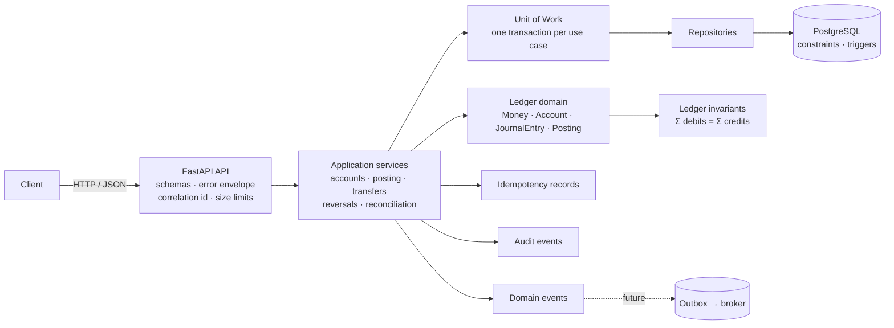
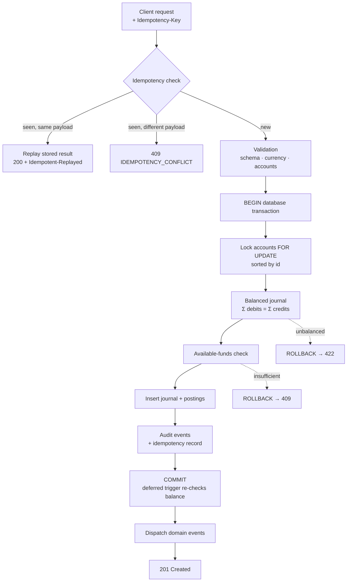
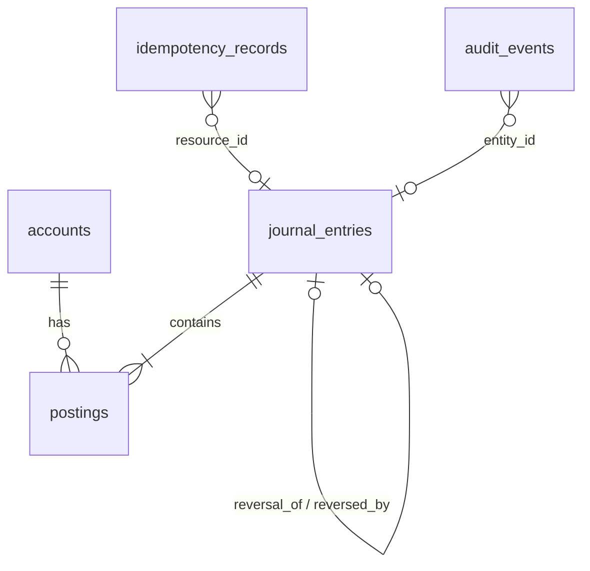

# CoreBank Ledger

CoreBank Ledger is a production-style educational double-entry ledger service
demonstrating the engineering controls behind financial transaction systems.

Built with Python 3.12, FastAPI and PostgreSQL, it records every movement of
value as a balanced journal entry and derives all balances from those entries.
The code is small enough to read in an afternoon and the test suite proves the
controls rather than just the happy path.

> **Disclaimer.** This project is an independent educational implementation
> using synthetic data and generic banking concepts. It is not affiliated
> with, derived from, or representative of any production banking system.

**Core strengths**

* Double-entry integrity: every posted entry satisfies `SUM(debits) == SUM(credits)`
* Idempotent processing: persistent `Idempotency-Key` handling, safe under concurrent retries
* Atomic transactions: journal, postings, audit and idempotency rows commit together or not at all
* Immutable postings: no updates or deletes once posted, enforced down to database triggers
* Reversals: corrections are new, linked entries; history is never rewritten
* Reconciliation: trial balance and ledger-wide integrity check derived from postings
* Concurrency-aware processing: ordered row locks, optimistic versioning, race tests
* PostgreSQL safeguards: constraints and deferred triggers reinforce the domain rules
* Rigorous automated testing: unit, integration on real PostgreSQL, property-based and API suites

[](https://github.com/Adetlo/corebank-ledger/actions/workflows/ci.yml)


---

## Contents

1. [Project overview](#1-project-overview)
2. [Why this project exists](#2-why-this-project-exists)
3. [Banking and ledger concepts demonstrated](#3-banking-and-ledger-concepts-demonstrated)
4. [Architecture](#4-architecture)
5. [Ledger invariants](#5-ledger-invariants)
6. [Technology stack](#6-technology-stack)
7. [Repository structure](#7-repository-structure)
8. [Data model](#8-data-model)
9. [Quick start](#9-quick-start)
10. [Docker quick start](#10-docker-quick-start)
11. [API examples](#11-api-examples)
12. [Demo scenario](#12-demo-scenario)
13. [Testing](#13-testing)
14. [Security](#14-security)
15. [Design decisions](#15-design-decisions)
16. [Limitations](#16-limitations)
17. [Roadmap](#17-roadmap)
18. [Disclaimer](#18-disclaimer)

---

## 1. Project overview

CoreBank Ledger is a small but complete **core ledger**: the component of a
banking platform that records every movement of value as balanced
double-entry journal entries and answers "what is the balance of this
account?" by deriving it from those entries.

It exposes a REST API to:

* create ledger accounts (asset, liability, equity, income, expense),
* post balanced journal entries,
* transfer value between accounts,
* reverse posted entries without ever editing history,
* derive balances and trial balances,
* run ledger-wide integrity checks,
* query an append-only audit trail.

Every financial mutation is **atomic**, **idempotent** and **immutable once
posted**. The rules are enforced in the domain model, re-checked in the
application transaction and reinforced by PostgreSQL constraints and triggers.

## 2. Why this project exists

Most "banking" sample projects are CRUD applications with a `balance` column.
Real ledgers are different: money is never updated in place, every change is
a balanced pair of postings, retries must be safe, and the books must
reconcile to zero at any point in time.

This repository exists to demonstrate those properties with code that can be
read in an afternoon, run with one command, and verified by a test suite that
proves the invariants rather than just the happy path. It is intended as an
engineering portfolio piece for senior engineering, fintech, banking
technology and architecture roles.

## 3. Banking and ledger concepts demonstrated

| Concept                     | Where                                                                      |
|-----------------------------|----------------------------------------------------------------------------|
| Double-entry accounting     | `domain/ledger.py`: every entry has debits equal to credits                |
| Chart of accounts and normal balances | `domain/accounts.py`: ASSET/EXPENSE are debit-normal, LIABILITY/EQUITY/INCOME credit-normal |
| Journal entries and postings| `JournalEntry` with immutable `Posting` legs                               |
| Transfers as journal entries| `domain/transactions.py` translates "move value A→B" into balanced legs     |
| Idempotency                 | Persistent `Idempotency-Key` records written in the posting transaction    |
| Atomicity                   | One database transaction per use case (`UnitOfWork`)                       |
| Immutability and reversals  | No updates/deletes; corrections are linked reversal entries                |
| Balance derivation          | Balances are `SUM` over postings, optionally as of a date                  |
| Reconciliation              | Trial balance per currency; ledger check across currencies                 |
| Concurrency control         | Row locks in deterministic order; optimistic versioning; race tests        |
| Available-funds control     | Configurable per account; enforced under lock                              |
| Auditability                | Append-only audit events with correlation ids and actors                   |
| Financial precision         | `Decimal` money with per-currency minor units; floats rejected             |
| Payment message adaptation  | ISO 20022-inspired simplified instruction → internal transfer              |
| Domain events / outbox      | In-process events now; transactional outbox documented                     |

## 4. Architecture

Clean, layered architecture with dependencies pointing inwards. Full detail
in [`docs/ARCHITECTURE.md`](docs/ARCHITECTURE.md).



### Transaction flow



## 5. Ledger invariants

Documented with enforcement points and proving tests in
[`docs/LEDGER_INVARIANTS.md`](docs/LEDGER_INVARIANTS.md).

| # | Invariant                                          | Enforced in                                      |
|---|----------------------------------------------------|--------------------------------------------------|
| 1 | `SUM(debits) == SUM(credits)` for every posted entry | domain, application, deferred DB trigger       |
| 2 | Posted entries and postings are immutable          | frozen dataclasses, no edit endpoints, DB triggers |
| 3 | A transaction posts atomically                     | unit of work, PostgreSQL transaction             |
| 4 | Idempotent retries cannot duplicate economic events| persistent keys + unique constraint              |
| 5 | Reversals preserve history                         | new linked entry; original never changes         |
| 6 | Balances are derived from ledger postings          | no balance column; `SUM` queries                 |

## 6. Technology stack

| Layer           | Choice                                                     |
|-----------------|------------------------------------------------------------|
| Language        | Python 3.12                                                |
| API             | FastAPI, Pydantic v2                                       |
| Persistence     | SQLAlchemy 2.x, Alembic, PostgreSQL 16, psycopg 3          |
| Testing         | pytest, Hypothesis, FastAPI TestClient, embedded PostgreSQL (`pgserver`) |
| Quality         | ruff, mypy (strict), bandit, pip-audit                     |
| Packaging       | uv + `pyproject.toml` + `uv.lock`                          |
| Containers      | Docker multi-stage image, Docker Compose                   |
| CI              | GitHub Actions with a PostgreSQL service container         |

## 7. Repository structure

```
corebank-ledger/
├── src/corebank/
│   ├── api/                  # FastAPI routes, dependencies, errors, middleware, presenters
│   │   └── routes/           # accounts, journal_entries, transfers, reconciliation, payments, health
│   ├── application/          # use cases: account, posting, transfer, reversal, reconciliation services
│   │   ├── unit_of_work.py   # one transaction per use case, post-commit event dispatch
│   │   └── idempotency.py    # persistent Idempotency-Key guard
│   ├── domain/               # money, accounts, ledger (journal/postings), transactions, events, exceptions
│   ├── infrastructure/       # SQLAlchemy engine, ORM models, repositories
│   ├── integrations/         # ISO 20022-inspired simplified payment adapter
│   ├── schemas/              # pydantic request/response DTOs
│   ├── config.py             # environment configuration
│   ├── logging.py            # structured JSON logging with correlation ids
│   └── main.py               # ASGI entry point
├── migrations/               # Alembic schema + invariant triggers
├── tests/
│   ├── unit/                 # domain and config tests (no database)
│   ├── integration/          # services against PostgreSQL: atomicity, locks, triggers, races
│   ├── property/             # Hypothesis properties: balancing, reversal, idempotency
│   └── api/                  # HTTP contract tests
├── scripts/                  # seed_demo.py, demo.py
├── examples/                 # request bodies and an .http file
├── docs/                     # ARCHITECTURE, LEDGER_INVARIANTS, API, SECURITY, DATA_MODEL, OUTBOX, ADR/
├── docker/entrypoint.sh      # runs migrations then the server
├── .github/workflows/ci.yml  # lint, types, tests + coverage, audits, image build
├── Dockerfile · docker-compose.yml · pyproject.toml · uv.lock · alembic.ini
├── .env.example · .gitignore · LICENSE · SECURITY.md · CONTRIBUTING.md
```

## 8. Data model

Five tables, UUID keys, constraints that mirror the domain rules, and three
triggers that make posted rows immutable and verify balance at commit. See
[`docs/DATA_MODEL.md`](docs/DATA_MODEL.md).



| Table                 | Purpose                                                          |
|-----------------------|------------------------------------------------------------------|
| `accounts`            | Chart of accounts; `normal_balance` derived from type; no balance column |
| `journal_entries`     | One accounting transaction; status, dates, reversal links, metadata |
| `postings`            | Debit/credit legs, `NUMERIC(19,4) > 0`, immutable                |
| `idempotency_records` | `(scope, key)` unique; payload hash; stored result               |
| `audit_events`        | Append-only trail with correlation id and actor                  |

## 9. Quick start

Prerequisites: [uv](https://docs.astral.sh/uv/) (installs Python 3.12 for
you) and a PostgreSQL 16 instance for running the API. **Tests need nothing
extra**: they start an embedded PostgreSQL automatically.

```bash
git clone https://github.com/Adetlo/corebank-ledger.git
cd corebank-ledger
uv sync                                  # dependencies + dev tools
uv run pytest                            # full suite against embedded PostgreSQL

cp .env.example .env                     # point DATABASE_URL at your PostgreSQL
uv run alembic upgrade head              # create schema + triggers
uv run uvicorn corebank.main:app --reload
open http://127.0.0.1:8000/docs
```

Quality gates:

```bash
uv run ruff check . && uv run ruff format --check .
uv run mypy
uv run pytest --cov
uv run bandit -c pyproject.toml -r src
```

## 10. Docker quick start

```bash
docker compose up --build            # API on http://localhost:8000, PostgreSQL on 5432
curl localhost:8000/health/ready
uv run python scripts/demo.py        # end-to-end synthetic demonstration
docker compose down -v               # stop and remove the volume
```

The image is a multi-stage build (uv-resolved dependencies, slim runtime,
non-root user, health check). The entrypoint applies Alembic migrations
before starting uvicorn; set `RUN_MIGRATIONS=false` to skip.

## 11. API examples

Full reference with every endpoint, error code and sample payload in
[`docs/API.md`](docs/API.md). Interactive documentation at `/docs` and `/redoc`.

Create an account:

```bash
curl -s -X POST localhost:8000/api/v1/accounts -H 'Content-Type: application/json' \
  -d '{"account_name": "Synthetic Customer Current Account", "account_type": "LIABILITY", "currency": "GBP"}'
```

Post a balanced journal entry (the `Idempotency-Key` makes retries safe):

```bash
curl -s -X POST localhost:8000/api/v1/journal-entries \
  -H 'Content-Type: application/json' -H 'Idempotency-Key: dep-demo-0001' \
  -d '{
    "reference": "DEP-DEMO-0001",
    "description": "Synthetic deposit",
    "booking_date": "2026-10-13",
    "postings": [
      {"account_id": "<settlement-asset-id>",    "direction": "DEBIT",  "amount": "1000.00", "currency": "GBP"},
      {"account_id": "<customer-liability-id>",  "direction": "CREDIT", "amount": "1000.00", "currency": "GBP"}
    ]
  }'
```

An unbalanced entry (`999.99` vs `1000.00`) is rejected:

```json
{"error": {"code": "UNBALANCED_JOURNAL", "message": "Journal entry debits and credits must balance.",
           "correlation_id": "…", "details": {"difference": "-0.01", "total_debits": "999.99", "total_credits": "1000.00", "currency": "GBP"}}}
```

Transfer, balance and trial balance:

```bash
curl -s -X POST localhost:8000/api/v1/transfers \
  -H 'Content-Type: application/json' -H 'Idempotency-Key: trf-demo-0001' \
  -d '{"source_account_id": "<customer-a>", "destination_account_id": "<customer-b>",
       "amount": "250.00", "currency": "GBP", "reference": "TRF-DEMO-0001", "value_date": "2026-10-13"}'

curl -s localhost:8000/api/v1/accounts/<customer-a>/balance
curl -s 'localhost:8000/api/v1/reconciliation/trial-balance?currency=GBP'
```

```json
{"currency": "GBP", "as_of_date": null, "accounts": [...],
 "total_debits": "1255.00", "total_credits": "1255.00", "difference": "0.00", "balanced": true}
```

Reverse an entry (original stays immutable, gets `status=REVERSED` and `reversed_by`):

```bash
curl -s -X POST localhost:8000/api/v1/journal-entries/<id>/reverse \
  -H 'Content-Type: application/json' -H 'Idempotency-Key: rev-demo-0001' -d '{"reason": "Fee waived"}'
```

## 12. Demo scenario

### Accounting model used by the demo

* Customer deposit accounts are **liabilities of the bank**: the balance is
  what the bank owes the customer. Crediting a customer account increases the
  bank's liability (the customer has more); debiting it decreases it.
* The settlement account is a bank **asset** (cash the bank holds). Assets are
  debit-normal: debits increase them.
* **Initial funding** of a customer is therefore `DEBIT settlement asset /
  CREDIT customer liability`: the bank holds more cash and owes more.
* A **transfer** between two customer accounts is `DEBIT sender liability /
  CREDIT receiver liability`: the bank owes the sender less and the receiver
  more; total liabilities and total assets are unchanged.
* A **fee** is `DEBIT customer liability / CREDIT fee income`: the customer's
  claim falls and the bank recognises income.
* A **reversal** repeats the original legs with directions swapped, so the net
  effect of entry plus reversal is zero while both remain in the history.

### Steps

`scripts/demo.py` runs the following against a live API and asserts the
ledger stays balanced throughout:

1. Seed synthetic accounts (Cash / Settlement GBP, Synthetic Customer A and B, Fee Income, Operating Expense, Suspense Account).
2. Fund Customer A: debit settlement asset, credit customer liability (GBP 1000.00).
3. Prove an unbalanced entry is rejected (`422 UNBALANCED_JOURNAL`).
4. Transfer GBP 250.00 from Customer A to Customer B, replay it with the same key (no double posting), and show the conflict on a changed payload.
5. Charge a GBP 5.00 synthetic service fee.
6. Print balances and the trial balance.
7. Reverse the fee; show the second reversal attempt is refused; print the audit trail.
8. Print final balances, trial balance and ledger check.

Final trial balance from a run (`uv run python scripts/demo.py` against `docker compose up`):

```
=== 8. Final balances and trial balance ===
  Cash / Settlement GBP         1000.00 GBP   (dr 1000.00, cr 0.00)
  Synthetic Customer A           750.00 GBP   (dr 255.00, cr 1005.00)
  Synthetic Customer B           250.00 GBP   (dr 0.00, cr 250.00)
  Fee Income                       0.00 GBP   (dr 5.00, cr 5.00)
  account                  type            debits      credits          net
  Cash / Settlement GBP    ASSET          1000.00         0.00      1000.00
  Operating Expense        EXPENSE           0.00         0.00         0.00
  Fee Income               INCOME            5.00         5.00         0.00
  Synthetic Customer A     LIABILITY       255.00      1005.00       750.00
  Suspense Account         LIABILITY         0.00         0.00         0.00
  Synthetic Customer B     LIABILITY         0.00       250.00       250.00
  TOTAL                                   1260.00      1260.00
  difference=0.00 balanced=True
  ledger-check balanced=True currencies=['GBP']

Demo complete: the ledger remained balanced throughout.
```

## 13. Testing

The strategy is to test each ledger control at the layer that owns it, and
to test the database-backed controls against a **real PostgreSQL** so that
row locks, deferred constraint triggers and unique-constraint races behave
exactly as in production. Locally an embedded PostgreSQL starts automatically;
CI uses a service container.

```bash
uv run pytest                 # whole suite, a few seconds
uv run pytest tests/unit      # pure domain tests, no database
uv run pytest --cov           # coverage report (CI enforces a floor of 85%)
```

| Suite               | Highlights                                                                                  |
|---------------------|---------------------------------------------------------------------------------------------|
| `tests/unit`        | Money precision and float rejection, normal-balance math, balancing rule, immutability, reversal construction, transfer translation, config masking |
| `tests/integration` | Rollback after a simulated failure mid-transaction, DB triggers rejecting tampering and unbalanced raw rows, idempotency replay/conflict and an 8-thread same-key race, 12 racing transfers never overdrawing, opposite-direction transfers without deadlock, reconciliation |
| `tests/property`    | Hypothesis: every generated balanced entry posts balanced and every perturbation is rejected; transfer + reversal restores balances despite unrelated activity; replays never increase the posting count |
| `tests/api`         | Status codes, stable error envelope and codes, pagination, filters, idempotency headers, request-size limit, correlation ids, health probes, masked 500/503 |

The concurrency and idempotency tests are the ones worth reading first:
they start real threads against one account and assert that exactly the
fundable transfers succeed and that a shared idempotency key posts once.

## 14. Security

Authentication is deliberately out of scope for v1; the service is designed
to sit behind an authenticating gateway, and
[`docs/SECURITY.md`](docs/SECURITY.md) describes how OAuth2/OIDC (for example
Microsoft Entra ID) would be integrated. What *is* implemented: strict input
validation, request-size limits, ORM-only data access, masked secrets, no
body logging, stable non-leaking errors, DB-level tamper protection, a
non-root container, and dependency/static security audits in CI. See
[`SECURITY.md`](SECURITY.md) for the reporting policy.

## 15. Design decisions

Architecture Decision Records in [`docs/ADR/`](docs/ADR):

* [0001 Use Decimal for money](docs/ADR/0001-use-decimal-for-money.md)
* [0002 Postings are immutable](docs/ADR/0002-postings-are-immutable.md)
* [0003 Ledger as source of truth](docs/ADR/0003-ledger-as-source-of-truth.md)
* [0004 Idempotency persistence](docs/ADR/0004-idempotency-persistence.md)
* [0005 PostgreSQL transaction boundaries](docs/ADR/0005-postgresql-transaction-boundaries.md)

Other notable choices:

* **Transfers require accounts with the same normal balance.** "A→B" means A
  decreases and B increases; mixed types cannot balance as two legs, so a
  deposit from a settlement asset to a customer is booked as an explicit
  journal entry rather than guessed.
* **Available funds are domain-aware.** Customer LIABILITY accounts cannot go
  negative by default; ledger/control accounts can. Overridable per account.
* **Single-currency entries.** FX would need position accounts and rates.
* **In-process domain events** with a documented
  [transactional outbox](docs/OUTBOX.md) path instead of a broker for show.

## 16. Limitations

These are conscious scope decisions for an educational v1, not oversights.
The project is **not** production-ready for a regulated banking deployment
and does not claim to be.

* **Authentication and authorisation are intentionally out of scope.** The
  service is designed to sit behind an authenticating gateway; the OAuth2/OIDC
  integration path is documented in `docs/SECURITY.md`.
* **Single PostgreSQL node.** No sharding, read replicas or multi-region
  consistency. Hot accounts serialise on row locks, so per-account throughput
  is bounded by lock hold time.
* **No distributed event platform.** Domain events are dispatched in-process;
  the transactional outbox design in `docs/OUTBOX.md` is the documented next step.
* **No balance snapshot optimisation.** Balances are aggregated from postings on
  every call, which is correct by construction but grows with volume.
* **No idempotency expiry policy.** Records are kept indefinitely; a retention
  job is documented, not implemented.
* No FX, interest, pricing engine, holds/authorisations or statement generation.
* `PENDING`/`FAILED` journal statuses exist in the model but every API path
  posts synchronously, so they are not reachable through the API.
* The ISO 20022-inspired adapter is a teaching simplification, not a
  standards implementation.

## 17. Roadmap

* OAuth2/OIDC authentication with scoped permissions.
* Balance snapshot projection with reconciliation job.
* Transactional outbox + relay (Kafka or cloud queue).
* Idempotency record retention and metrics (Prometheus/OpenTelemetry).
* Multi-currency entries with FX position accounts.
* Pending/authorised holds and value-dated availability.
* Statement and posting-export endpoints.

## 18. Disclaimer

This project is an independent educational implementation using synthetic
data. It is not affiliated with, derived from, or representative of any
production banking system. All account numbers, names and amounts are
fictional. Do not use it to process real financial or personal data.

Licensed under the [MIT License](LICENSE).
