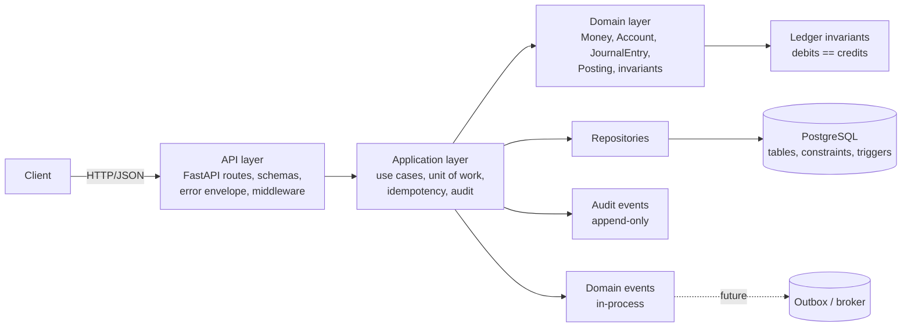
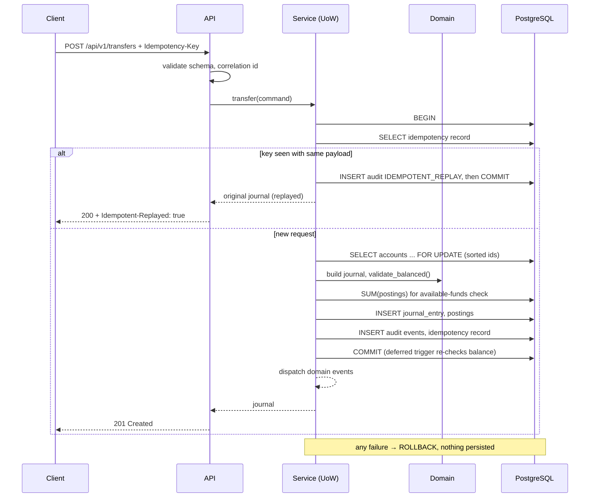
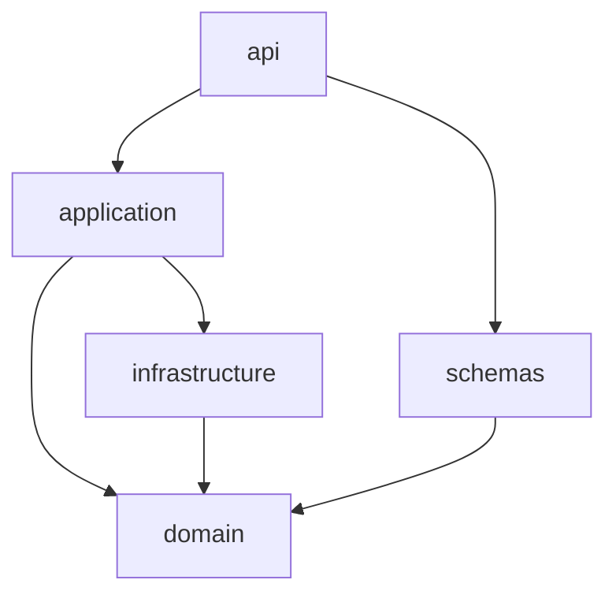

# Architecture

CoreBank Ledger follows a clean, layered architecture. Dependencies point
**inwards**: the API depends on the application layer, which depends on the
domain and on repository interfaces; the domain depends on nothing.

## Layers

### API layer (`src/corebank/api`)

* `routes/` map HTTP to use cases. They validate input with pydantic schemas,
  call one service method, and render a response through `presenters.py`.
* `errors.py` owns the stable error envelope and the exception-to-status map.
* `middleware.py` adds correlation ids (`X-Correlation-ID`), request-size
  limits (413) and access logging as pure ASGI middleware.
* `dependencies.py` wires settings, the unit-of-work factory and services.

The API layer contains **no business rules**. Even if a client bypassed its
validation, the application and domain layers (and the database) would still
reject an unbalanced or immutable-violating request.

### Application layer (`src/corebank/application`)

Use-case orchestration. Each service method is one database transaction:

| Service                  | Use cases                                                  |
|--------------------------|------------------------------------------------------------|
| `AccountService`         | create, get, list, balance, status transitions             |
| `PostingService`         | post a client-supplied journal entry                       |
| `TransferService`        | translate a transfer into a journal entry and post it      |
| `ReversalService`        | reverse a posted entry                                     |
| `ReconciliationService`  | trial balance, ledger-wide integrity check                 |
| `JournalQueryService`    | get/search entries, audit trail                            |

`posting_service.post_entry()` is the **single code path** that creates
postings. Transfers and reversals build a `JournalEntry` and hand it to that
function, so every control (locking, status checks, balancing, available
funds, audit) applies uniformly.

`UnitOfWork` wraps a SQLAlchemy session, exposes repositories, and buffers
domain events until after a successful commit.

### Domain layer (`src/corebank/domain`)

Framework-free, fully unit-testable:

* `money.py`: `Money` value object, currency table, precision rules.
* `accounts.py`: account types, normal balances, status lifecycle, balance
  sign math.
* `ledger.py`: `Posting`, `JournalEntry`, `validate_balanced()` (the
  invariant), reversal construction, immutability guards.
* `transactions.py`: transfer → postings translation.
* `events.py`: in-process domain events.
* `exceptions.py`: stable error codes.

### Infrastructure layer (`src/corebank/infrastructure`)

* `models.py`: SQLAlchemy ORM models with check constraints and indexes.
* `repositories/`: translate between ORM rows and domain objects; contain
  the locking (`FOR UPDATE`) and aggregate queries.
* `database.py`: engine/session factory, readiness probe.
* `migrations/` (repo root): Alembic schema plus the invariant triggers.

## Transaction flow

## Dependency direction

`domain` imports nothing from the other packages. `schemas` are plain
pydantic DTOs shared by the API and the ISO 20022-inspired adapter.

## Cross-cutting concerns

* **Configuration**: `config.py` (pydantic-settings) reads the environment;
  secrets are masked in logs.
* **Logging**: JSON lines with `timestamp`, `level`, `logger`,
  `correlation_id`, `event`; request bodies are never logged.
* **Correlation**: the id flows from middleware → `RequestContext` → audit
  events and domain events, so a single id ties an HTTP request to its rows.
* **Errors**: domain exceptions carry a code; the API maps codes to statuses
  in exactly one place.

## What is deliberately not here

* Authentication/authorisation (see `docs/SECURITY.md`).
* Message brokers or an outbox implementation (see `docs/OUTBOX.md`).
* Multi-currency FX, interest accrual, product/pricing engines.
* Horizontal scaling patterns (sharding, CQRS read models).
