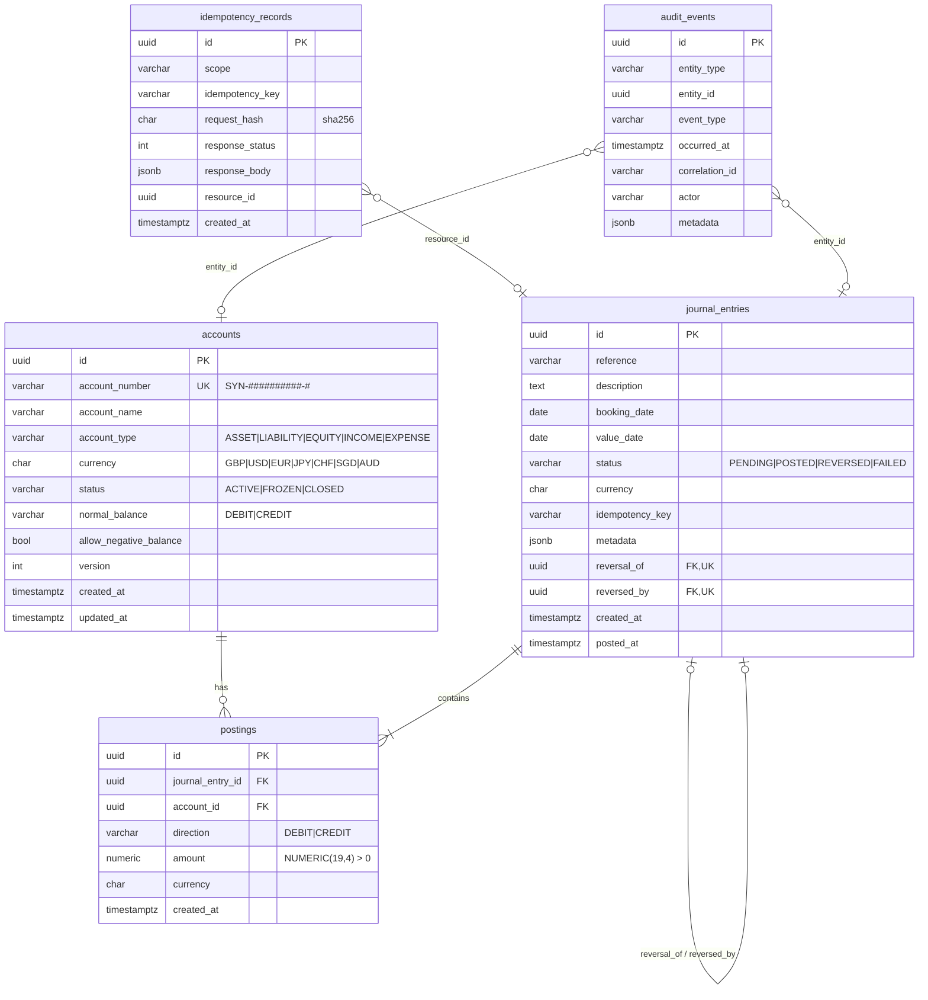

# Data Model

PostgreSQL schema managed by Alembic (`migrations/versions/0001_initial_ledger_schema.py`).
All primary keys are UUIDs generated by the application; all timestamps are
`timestamptz`.



## Tables

### `accounts`

One row per ledger account. `normal_balance` is derived from `account_type`
at creation and never changes. `version` supports optimistic concurrency for
status changes. There is **no balance column** (ADR 0003).

Constraints: `uq_accounts_account_number`, check constraints on type,
normal balance, status, currency and `version >= 1`.
Indexes: `(account_type, currency)`, `(status)`.

### `journal_entries`

One accounting transaction. `status` is `POSTED` or `REVERSED` for every row
written by the service (an entry is created and posted in the same
transaction; `PENDING`/`FAILED` exist for completeness and future async
flows). `metadata` holds non-sensitive context such as `{"kind": "TRANSFER"}`.

Constraints: `ck_journal_entries_posted_at` (posted/reversed rows must have
`posted_at`), `ck_journal_entries_self` (cannot reverse itself),
`uq_journal_entries_reversal_of`, `uq_journal_entries_reversed_by`
(one reversal per entry, one original per reversal).
Indexes: `reference`, `booking_date`, `status`, `idempotency_key`, `created_at`.

### `postings`

One leg of an entry. `amount` is always positive; the side is `direction`.
`currency` is denormalised onto the posting so aggregate queries never join
accounts.

Constraints: `ck_postings_direction`, `ck_postings_amount_positive`,
`ck_postings_currency`, FKs to `journal_entries` and `accounts`.
Indexes: `journal_entry_id`, `account_id`, `(account_id, journal_entry_id)`.

### `idempotency_records`

`scope` names the operation (`transfers.create`, `journal_entries.post`,
`journal_entries.reverse`). `request_hash` is SHA-256 over the canonical JSON
payload. `UNIQUE (scope, idempotency_key)`.

### `audit_events`

Append-only. The application exposes no update or delete for this table.
Indexed by `(entity_type, entity_id)`, `correlation_id`, `occurred_at`.

## Triggers (invariants in the storage layer)

| Trigger                          | Table            | Rule                                                                 |
|----------------------------------|------------------|----------------------------------------------------------------------|
| `trg_postings_immutable`         | postings         | `BEFORE UPDATE OR DELETE`: always raises `IMMUTABLE_POSTING`         |
| `trg_journal_entries_immutable`  | journal_entries  | posted/reversed rows: only `POSTED → REVERSED (+reversed_by)` allowed; no delete |
| `trg_postings_balanced`          | postings         | `DEFERRABLE INITIALLY DEFERRED`: at commit, effective entries must balance |
| `trg_journal_entries_balanced`   | journal_entries  | same check when an entry becomes posted/reversed                     |

Triggers raise with `ERRCODE restrict_violation` / `check_violation` so the
error class is visible to the driver.

## Balance and trial-balance queries

```sql
-- balance of one account as of a date
SELECT COALESCE(SUM(CASE WHEN p.direction = 'DEBIT'  THEN p.amount END), 0) AS debit_total,
       COALESCE(SUM(CASE WHEN p.direction = 'CREDIT' THEN p.amount END), 0) AS credit_total
FROM postings p
JOIN journal_entries j ON j.id = p.journal_entry_id
WHERE p.account_id = :account_id
  AND j.status IN ('POSTED', 'REVERSED')
  AND j.booking_date <= :as_of_date;
```

The trial balance runs the same aggregate grouped by account and joins all
accounts of the currency (accounts with no postings appear with zeros).

## Optional: balance snapshots

Not implemented. If added, `balance_snapshots(account_id, as_of_date,
debit_total, credit_total, last_posting_created_at)` would be a **derived
projection**, rebuilt from postings, validated by a reconciliation job, and
never written by request handlers.
