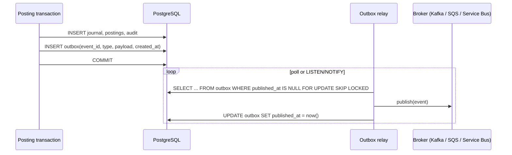

# Transactional Outbox (future enhancement)

## Problem

Downstream systems (notifications, fraud screening, a general-ledger
warehouse, statements) need to know when a journal is posted. Publishing to
a broker *inside* the request has two failure modes:

* publish succeeds, commit fails → consumers see an event for money that
  never moved;
* commit succeeds, publish fails → money moved and nobody heard.

## v1 behaviour

Domain events (`JournalPosted`, `TransferCompleted`, `JournalReversed`,
`AccountCreated`) are dispatched **in-process after commit**
(`UnitOfWork.commit()`), and the only subscriber logs them. This is honest
about scope: there is no broker, so nothing can be lost in transit, but
nothing leaves the process either.

## Target design

1. **Write the event in the same transaction** as the postings into an
   `outbox` table (`id`, `aggregate_type`, `aggregate_id`, `event_type`,
   `payload jsonb`, `created_at`, `published_at`).
2. **A relay process** reads unpublished rows in batches using
   `FOR UPDATE SKIP LOCKED` (safe with multiple relay instances), publishes
   them, and marks them published. Debezium-style CDC on the table is an
   alternative that avoids polling.
3. **At-least-once delivery**: a crash between publish and mark re-sends the
   event. Consumers must be idempotent, keyed on `event_id`, exactly as the
   API is keyed on `Idempotency-Key`.
4. **Ordering**: order per aggregate by `created_at`/sequence and partition
   the topic by `aggregate_id` (account or journal id).
5. **Retention**: delete published rows after N days; the audit table, not the
   outbox, is the record of truth.

## Why not implement it now

Adding Kafka would add a broker, a relay, consumer contracts and operational
surface without changing any ledger guarantee. The in-process dispatcher has
the same interface a relay would subscribe to, so the migration path is:
replace `log_event` with an `OutboxWriter` that inserts into the outbox table
through the active unit of work.
